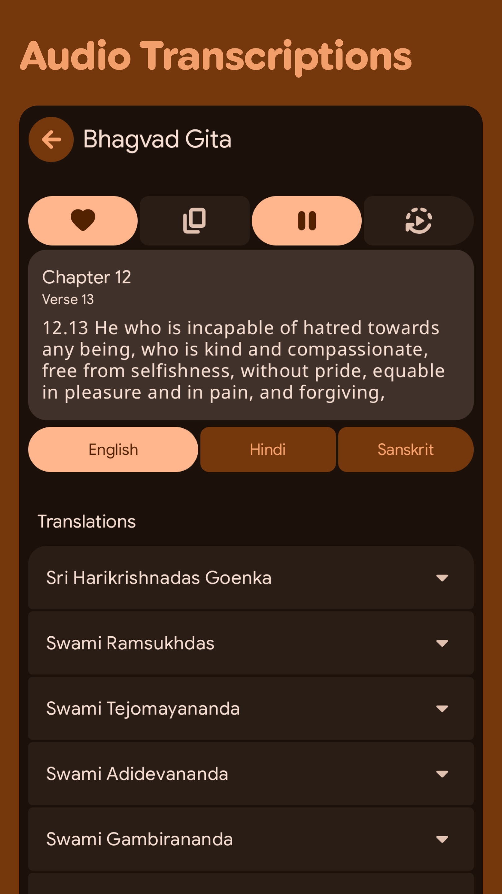
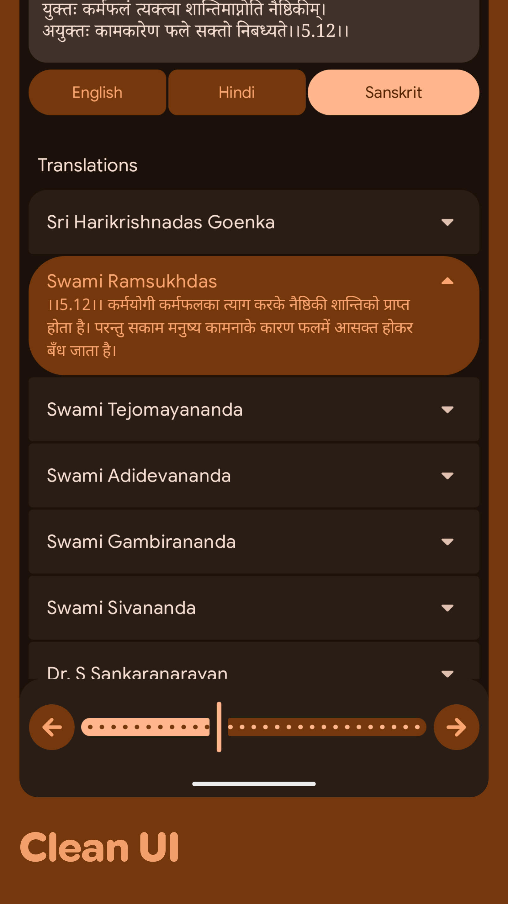

[](https://play.google.com/store/apps/details?id=com.shub39.dharmik.online)
[](https://github.com/shub39/Dharmik/releases)

# Screenshots 

|  |  |
|:------------------------------------------------------------------:|:------------------------------------------------------------------:|
|  |  |


# Motivation 

I built this for my parents. I find the existing Gita apps out there quite tasteless and riddled 
with ads and unnecessary features. So I built my own focused on the content of the book

# References and Inspiration

- [Dharmic Data](https://github.com/bhavykhatri/DharmicData) for the texts
- [Gita Supersite](https://www.gitasupersite.iitk.ac.in/), primary source and audio for the verses

# Security

SHA-256 fingerprint for the signing certificate used for GitHub releases
```text
0F:E1:B9:F4:4A:4D:B9:7E:C5:09:48:F5:18:9F:6B:43:00:71:6C:C6:D4:84:3F:56:98:D6:14:A2:15:2E:21:88
```
